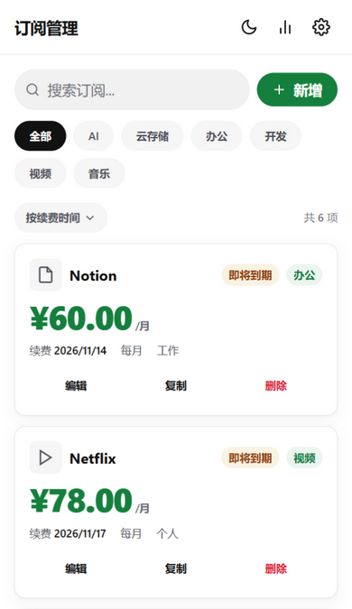
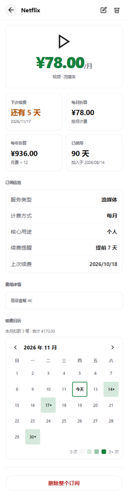
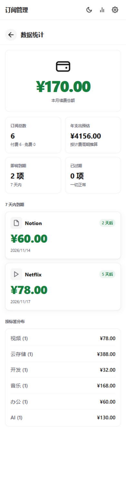
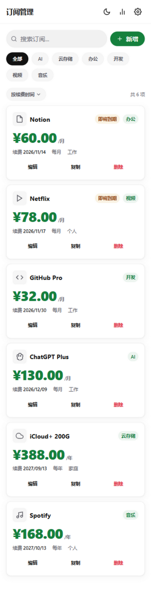

<div align="center">


# 订阅管理

**把每一笔订阅变成看得见的账单，让续费日不再突然袭击**

纯本地 · 不登录 · 零依赖的订阅管理 PWA

<p>
  
  
  
  
  
</p>

[在线使用](https://edward8n25.github.io/subscription-manager/) · [快速开始](#快速开始) · [更新日志](CHANGELOG.md)



<sub>首页 · 浅色主题 · 四色配色与深浅双主题</sub>

</div>

---

## ✨ 核心亮点

- **订阅台账**：新增 / 编辑 / 复制 / 删除，名称、标签、服务类型、计费方式、续费日期一次填全
- **到期提醒徽章**：7 天内「即将到期」、过期「已过期」自动标记，列表与统计都看得到
- **大数字 + 四宫格**：卡片放大价格；详情页月/年折算、已使用天数、续费倒计时一目了然
- **月历 + 扣款摘要**：4 档色阶，续费日「日期 + 角标」，点开看当天明细；顶部「本月扣款 N 笔 · 合计 ¥X」
- **统计页**：本月续费总额、年支出预估、7 天内到期、已过期、按标签成本分布
- **四配色 × 深浅主题**：经典绿 / 深海蓝 / 蔷薇紫 / 落日橙，对比度 128 项对守门
- **数据双写 + 导入消毒**：主备 key 双写、损坏自动回退、旧版自动迁移；导入强制归一化
- **全屏表单 + 键盘可达**：整屏表单（取消/保存常驻）、卡片 Tab+Enter、44px 命中区与焦点环
- **零依赖零构建**：纯 HTML + 原生 JS（ES5 单 IIFE），双击即用

## 📸 界面预览

<table>
  <tr>
    <td align="center" width="33%"><br /><sub>详情 · 价格四宫格 + 月历摘要</sub></td>
    <td align="center" width="33%"><br /><sub>统计 · 本月总额 + 到期清单</sub></td>
    <td align="center" width="33%"><br /><sub>列表 · 经典绿 · 卡片等高</sub></td>
  </tr>
</table>

## 🚀 快速开始

无需安装、无需构建，数据只存在你的浏览器里。

```bash
# 方式一：直接在线使用（可安装为 PWA）
https://edward8n25.github.io/subscription-manager/

# 方式二：本地运行（含 Service Worker 离线能力）
python -m http.server 8080
# 或：.\scripts\dev-server.ps1
```

## 🔒 隐私与数据

- **100% 本地**：数据存浏览器 localStorage，不登录、不上传、零外部请求
- **双 key 冗余**：主 key + `.bak` 双写；任一侧损坏自动从另一侧恢复
- **导入消毒**：非法 id 重生成、价格数字化、枚举落默认、超长截断
- **可迁移**：JSON 导出 / 导入（合并按 id 去重，覆盖以备份为准）；旧版 key 自动迁移
- **已知边界**：不做到期推送（纯前端无可靠定时 API）、不做跨设备同步（换设备用导出导入）

## 🧪 质量与测试

| 脚本 | 断言 | 覆盖 |
|---|---|---|
| `tests/smoke-test.js` | 32 | 加载 / 渲染 / 脏数据不崩 / 备份恢复 / v1 迁移 / 折算口径 |
| `tests/contrast-check.js` | 128 项对 | 4 配色 × 2 主题 token 对 + 亮度带对齐 |
| `tests/style-consistency.js` | 8 | 死 CSS / 类名失配 / 间距·圆角·内联 style 棘轮 |
| `tests/assert-batch2~11.js` | 155 | 各批次修复与功能回归（安全 / 数据 / UI / 交互） |

全部脚本在 CI 中执行，**失败不部署**。

## 🧰 技术栈

- **运行形态**：原生 HTML + CSS + JavaScript（ES5 语法 + ES2015 内置方法，不支持 IE11；单 IIFE），零依赖、零构建，托管在 GitHub Pages
- **数据层**：localStorage 双 key 冗余 + 版本迁移管道 + 导入归一化
- **离线能力**：Service Worker 导航与静态资源 network-first，在线拿最新、离线走缓存
- **质量守门**：13 个零依赖测试脚本，部署前在 CI 强制执行

## 🗺️ 路线

- **订阅归档（近期）**：已退订的订阅移入归档区，保留历史花费记录
- **月度账单日（近期）**：按扣款日聚合，配合薪资节奏看现金流
- **价格历史（可选）**：涨价 / 降价记录曲线，看清「订阅通胀」

## 📄 License

[MIT](LICENSE) © 2026

---

<details>
<summary>附录：调试入口、本地测试与目录结构</summary>

### 调试入口（URL 参数，仅开发 / 演示用）

| 参数 | 作用 |
|---|---|
| `#seed` | 灌入 6 条演示订阅（空库或演示数据直接灌；有真实数据先确认） |
| `?detail=<id>` | 直接打开指定订阅详情 |
| `?view=stats` | 直接打开统计页 |
| `?theme=dark` / `?theme=light` | 强制主题（截图用） |
| `tests/seed.html?run=1` | 测试夹具灌库 |

### 本地测试（需 Node 18+）

```bash
node tests/smoke-test.js
node tests/style-consistency.js
node tests/contrast-check.js
for f in tests/assert-batch*.js; do node "$f"; done
```

### 目录结构

```
subscription-manager/
├── index.html              # 入口：HTML + 全部内联 CSS
├── src/app.js              # 全部业务逻辑（单 IIFE）
├── sw.js                   # Service Worker
├── manifest.json           # PWA 清单
├── assets/icons/           # 图标三件套
├── docs/screenshots/       # README 截图
├── docs/badges/            # README 徽章（本地 SVG）
├── tests/                  # 13 个零依赖测试
├── scripts/                # 本地服务器 / 图标生成
└── .github/workflows/      # CI：测试通过才部署
```

</details>
