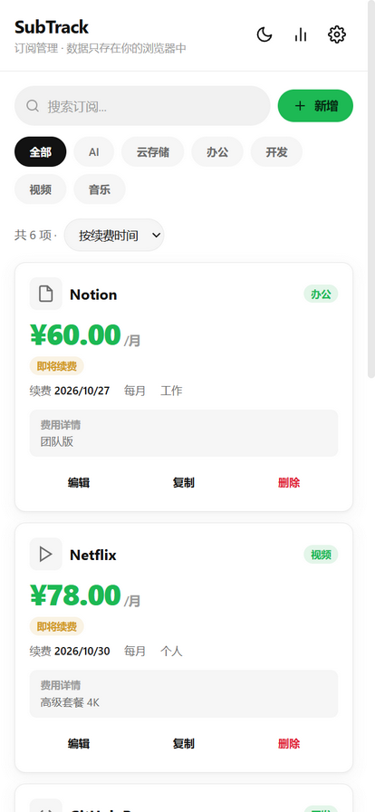
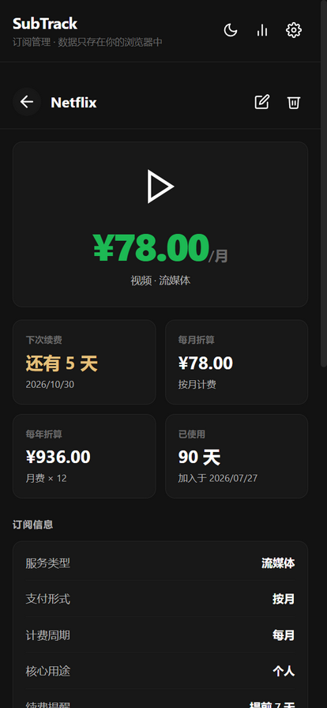
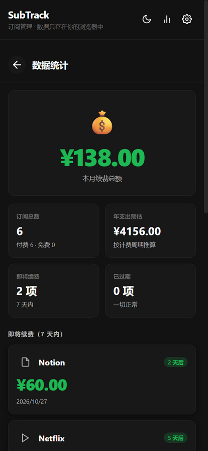
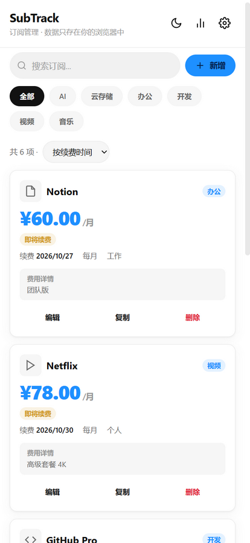

# SubTrack · 订阅管理

> **把每一笔订阅变成看得见的账单，让续费日不再突然袭击。**

一个轻量化的移动端优先订阅管理工具。**纯前端、数据完全本地、不登录、不上传**。

> 🌐 **在线使用**：<https://edward8n25.github.io/subscription-manager/>（GitHub Pages；数据仅存本机浏览器，刷新 / 换设备前请导出备份）



---

## 🤔 这些场景你一定经历过

- 各家会员散在十几个 App 里，**扣款短信来了才发现「原来这个还没退」**
- 年费会员每月到底摊多少钱？**详情页自动帮你折算成月 / 年成本**，别再心算了
- 月底一看账单吓一跳？**统计页直接告诉你本月要续费多少、一年要花多少**
- 想砍掉一些订阅又不知道砍哪个？**按标签看分布**，谁是成本大户一目了然
- 清了浏览器缓存，订阅清单全没了？**主 key + 备份 key 双写冗余，JSON 损坏自动回退**

---

## 📑 目录

- [✨ 核心亮点](#-核心亮点)
- [🎯 功能特性](#-功能特性)
- [🚀 快速开始](#-快速开始)
- [💾 数据与备份](#-数据与备份)
- [🛠️ 调试入口](#-调试入口)
- [🧰 技术栈](#-技术栈)
- [📂 目录结构](#-目录结构)
- [🗺️ 开发计划](#-开发计划)
- [🛡️ 隐私与安全](#-隐私与安全)
- [📜 License](#-license)

---

## ✨ 核心亮点

<table>
  <thead>
    <tr><th width="5%"></th><th width="24%" align="left">能力</th><th width="71%" align="left">说明</th></tr>
  </thead>
  <tbody>
    <tr><td align="center">🧾</td><td><strong>订阅台账</strong></td><td>新增 / 编辑 / 复制 / 删除，名称、标签、服务类型、支付形式、计费周期、提醒偏好一次填全</td></tr>
    <tr><td align="center">💰</td><td><strong>大数字价格</strong></td><td>卡片直接放大价格，重点一眼看到；详情页超大数字 + 四宫格数据</td></tr>
    <tr><td align="center">🧮</td><td><strong>自动折算</strong></td><td>月费 / 季费 / 年费统一折算成「每月成本」和「每年成本」，和统计页年支出预估同口径——别再自己按计算器</td></tr>
    <tr><td align="center">📅</td><td><strong>双视图日历</strong></td><td>月历（4 档色阶）+ 年热力图（GitHub 风格）——哪天要续费、一年集中在什么时候，一眼看穿</td></tr>
    <tr><td align="center">📊</td><td><strong>统计页</strong></td><td>本月续费总额 + 年支出预估 + 7 天内即将续费清单 + 按标签成本分布——月底账单不再有意外</td></tr>
    <tr><td align="center">🔔</td><td><strong>续费状态徽章</strong></td><td>「即将续费」（7 天内）/「已过期」自动标记，列表和统计都看得到</td></tr>
    <tr><td align="center">🔎</td><td><strong>搜索 / 筛选 / 排序</strong></td><td>按名称、标签模糊搜索；标签胶囊一键筛选；按续费时间 / 价格 / 名称排序，偏好自动记住</td></tr>
    <tr><td align="center">🎨</td><td><strong>四色配色</strong></td><td>Spotify 绿 / 亮蓝 / 蔷薇紫 / 落日橙，设置内一键切换，全站强调色联动（价格、日历色阶、标签、按钮全部跟着换）</td></tr>
    <tr><td align="center">🌓</td><td><strong>深浅主题</strong></td><td>浅 / 深 / 跟随系统，手动切换即时生效</td></tr>
    <tr><td align="center">🛡️</td><td><strong>数据双写</strong></td><td>主 key + <code>.bak</code> 备份双写；主 key 缺失或损坏自动从备份恢复并写回；旧版 <code>subtrack_data</code> 一次性自动迁移</td></tr>
    <tr><td align="center">🧼</td><td><strong>导入消毒</strong></td><td>导入的备份强制走归一化管道：非法 id 重生成、数值 / 枚举归一、超长截断——畸形文件不会弄坏应用</td></tr>
    <tr><td align="center">🚫</td><td><strong>防误关弹窗</strong></td><td>弹窗点遮罩不关闭（正在填的内容不会因误触丢失）；ESC 关最上层；关闭后焦点归还触发按钮</td></tr>
    <tr><td align="center">📦</td><td><strong>零依赖</strong></td><td>纯 HTML + 原生 JavaScript，零构建、零 npm，双击 index.html 就能用</td></tr>
  </tbody>
</table>

---

## 🎯 功能特性

### 💰 详情页四宫格 —— 一眼看穿一个订阅的真实成本

点开任意订阅，超大价格下面是四个数字：

- **下次续费**：还有 X 天（7 天内变警示色，过期显示「已过 X 天」）
- **每月折算**：年费 ÷ 12、季费 ÷ 3，摊到月的真实成本
- **每年折算**：月费 × 12，拉到年的真实账单
- **已使用**：从加入那天算起用了多久

下面还有完整字段列表和费用详情备注（首年折扣、涨价历史随手记）。



---

### 📊 统计页 —— 月底账单不再有意外

顶栏图表按钮进入，集中看钱的流向：

- **本月续费总额**：这个月要被扣多少钱
- **年支出预估**：按计费周期推算一整年
- **即将续费**（7 天内）与**已过期**清单
- **按标签分布**：视频 / 云存储 / AI… 谁是成本大户



---

### 📅 双视图日历

- **月历**：4 档色阶（无 / 1 次 / 2 次 / 3+ 次），今天描边高亮，可翻月
- **年热力图**：GitHub 贡献图风格，悬停看具体日期，全年续费密度一图看完

---

### 🎨 四色配色 + 深浅主题

设置里四色一键切换（Spotify 绿 / 亮蓝 / 蔷薇紫 / 落日橙），价格数字、日历色阶、标签胶囊、按钮全部联动换色，不留一点旧色残留。浅 / 深 / 跟随系统三模式主题独立于配色。



---

## 🚀 快速开始

### 方式一：双击 index.html（最快）

直接双击 `index.html`，浏览器即可使用。**所有数据存在浏览器 localStorage**。

> ⚠️ 某些浏览器对 `file://` 协议有限制（Service Worker 不工作），如果遇到 PWA 安装 / 离线不工作的问题，用方式二。

### 方式二：本地服务器（推荐，含 PWA / Service Worker）

```powershell
.\scripts\dev-server.ps1
# 然后访问 http://localhost:8080（可自定义端口：.\scripts\dev-server.ps1 -Port 3000）
```

### 方式三：PWA 安装到主屏

Chrome / Edge 打开页面 → 地址栏「安装」图标 → 添加到主屏。
iOS Safari 用「分享 → 添加到主屏幕」。

安装后可离线使用，体验接近原生 App。

---

## 💾 数据与备份

### 存储方案

- **所有数据存浏览器 localStorage**（主 key：`subtrack-v2`）
- **主 key + .bak 备份 key 双写冗余**：每次保存同时写两个 key；主 key 缺失、JSON 解析失败或结构非法时自动从备份恢复，并把恢复结果写回主 key
- 旧版数据（`subtrack_data`）在首次加载时**自动迁移**，迁移后旧 key 保留不动
- 浏览器清缓存 = 数据没了，**请定期导出**

### 导出与导入

设置 → 「导出 JSON 备份」/「导入备份」：

- 导出：下载 `subtrack-backup-YYYY-MM-DD.json`
- 导入：支持「合并」（按 id 去重）与「覆盖」两种模式
- 导入文件**强制消毒**：非法 id 重生成、价格数字化、枚举字段落默认值、超长文本截断——网上随便找的 JSON 也不会弄坏应用

### Schema 迁移

- 数据对象带 `v` 字段（schema 版本号），加载时统一走归一化管道
- **绝不**因版本不匹配清空数据

---

## 🛠️ 调试入口

URL 参数（开发 / 演示用）：

| 参数 | 作用 |
|---|---|
| `?detail=<id>` | 直接打开指定 id 的详情页 |
| `?view=stats` | 直接打开统计页 |
| `?theme=dark` / `?theme=light` | 强制主题（截图 / 演示用） |
| `#seed` | 灌入 6 条演示订阅。**带确认守卫**：空库或已是演示数据时直接灌，存在真实数据时先弹确认，绝不无声覆盖 |

测试夹具 `tests/seed.html` 需显式加 `?run=1` 才执行灌库。

例：`http://localhost:8080/index.html?detail=s1&theme=dark#seed`

---

## 🧰 技术栈

- 纯 HTML + 原生 JavaScript（**零依赖、零构建**）
- 全部 CSS 内联在 `index.html`（设计 token 体系：色彩语义 / 间距六档 / 圆角 / 阴影，棘轮守门）
- 全部业务逻辑在 `src/app.js`（约 1400 行单文件 IIFE，ES5）
- PWA：Web App Manifest + Service Worker（导航与静态资源均 network-first + 缓存回退，兼顾发版生效与离线可用）
- 兼容：Chrome / Edge / Safari / Firefox 最近 2 个大版本，iOS Safari 15+

设计基因来自 quit-tracker 样板（Spotify 深色基因 / 胶囊按钮 / 重点数字放大），并遵循自研《个人 PWA 开发规范 v3》。

---

## 📂 目录结构

```
subscription-manager/
├── index.html              ← 入口（HTML + 全部内联 CSS）
├── manifest.json           ← PWA 清单
├── sw.js                   ← Service Worker（离线缓存）
│
├── src/
│   └── app.js              ← 全部业务逻辑（单文件 IIFE）
│
├── assets/
│   └── icons/              ← icon.svg / icon-192.png / icon-512.png
│
├── scripts/
│   ├── dev-server.ps1      ← 启动本地服务器
│   └── gen-icons.ps1       ← System.Drawing 重新生成 PNG
│
├── docs/
│   ├── data-model.md       ← 数据模型说明
│   └── screenshots/        ← README 引用的功能截图
│
├── tests/
│   ├── smoke-test.js       ← 冒烟测试（32 项断言，`node tests/smoke-test.js` 运行）
│   ├── style-consistency.js ← 样式守门棘轮（死 CSS / 失配类名 / Token 阈值，可进 CI）
│   └── assert-batch2~9.js  ← 各批次修复与功能的静态断言（共 93 项）
│
├── CHANGELOG.md
├── LICENSE
└── README.md
```

---

## 🗺️ 开发计划

### 已完成（1.0.0，2026-10-25）

- [x] **全量盘点 + 分批修复**：数据层（导入消毒管道 / 备份双写 / 旧版迁移）、Service Worker（cache-first 改 network-first，发版可更新）、安全（onclick 注入面清零）、交互（弹窗栈 / 防误关 / Enter 接管 / toast 单例）、状态机（日历子状态复位 / 滚动位置记忆 / 折算口径统一）、UI 一致性（间距 / 圆角 / 阴影 / 内联全部 token 化，棘轮守门）
- [x] **四色配色**：Spotify 绿 / 亮蓝 / 蔷薇紫 / 落日橙
- [x] **a11y 补齐**：弹窗 role / aria / 焦点管理、`prefers-reduced-motion` 动效降级、viewport 恢复缩放
- [x] 测试体系：冒烟 + 各批次静态断言 + 样式棘轮，共 **133 项断言**

### 下一步（候选，按 ROI 排序）

- [ ] **订阅归档**：已退订的订阅移入归档区，保留历史花费记录
- [ ] **月度账单日**：日历上标注每月固定扣款日，配合薪资节奏看现金流
- [ ] **价格历史**：涨价 / 降价记录曲线，看清「订阅通胀」

### 已知能力边界（有意为之）

> ⚠️ 本工具**不提供到期推送提醒**。纯前端 PWA 在页面关闭后没有任何可用的 Web API 能在指定时刻唤醒本地通知（Periodic Background Sync 仅 Chromium 且受站点参与度门控，Web Push 需要服务端密钥）。与样板 quit-tracker 同一判断：与其交付一个「偶尔能响」的提醒，不如把「即将续费」徽章做显眼——需要处理时，用户自然会打开它。
>
> ⚠️ **不做账号与跨设备同步**。数据本地化是这个工具的隐私底线；换设备请用「导出 JSON → 导入」。

---

## 🛡️ 隐私与安全

- **100% 本地存储**：所有数据存浏览器 localStorage，不发送到任何服务器
- **不登录、不注册、不上传**
- **可离线使用**：PWA 安装后断网仍可使用全部功能
- **零外部网络请求**：无 CDN、无 Google Fonts、无埋点
- **开源透明**：所有代码可在 `src/app.js` 审计

---

## 🤝 致谢

设计基因与工程流程直接继承自姊妹项目 [habit-quit-tracker](https://github.com/Edward8n25/habit-quit-tracker)（戒断习惯追踪工具）——配色切换机制、数据双写、弹窗交互范式、测试体系与这份 README 的排版风格都源于它。

开发过程采用对话式 AI 协作工作流（全量盘点 → 分批修复 → 断言回归），过程沉淀于 CHANGELOG（完整审计与分批修复档案保留在本地）。

---

## 📜 License

[MIT License](LICENSE) © 2026

你可以自由使用、修改、分发本工具，包括商业用途，但请保留原作者版权声明。

---

<p align="center">
  <sub>订阅本身不贵，贵的是忘了它在扣钱。</sub>
</p>
